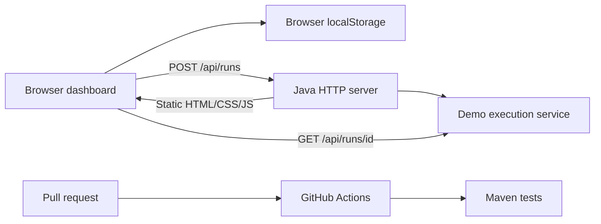
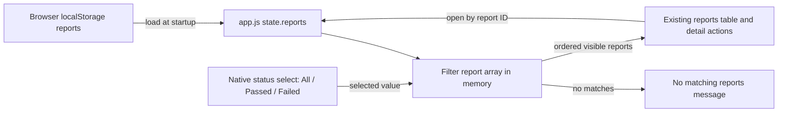
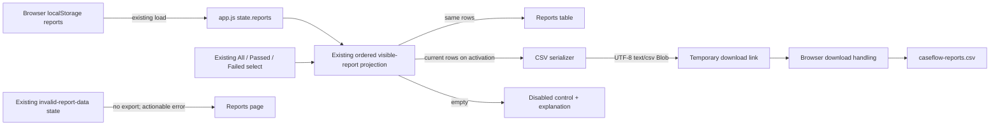
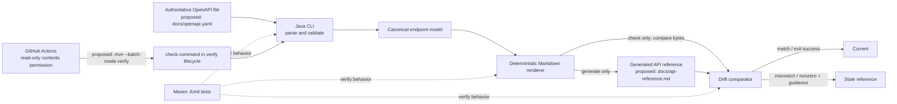

# Architecture

## Overview

The capstone has a dependency-free Java 17 HTTP server, a browser-based dashboard, and a deliberately simulated test runner. The browser stores test cases and report history in local storage. The Java server only serves the app and simulates asynchronous run status.



## Components

| Component | Responsibility |
|---|---|
| `DashboardServer` | Serves the UI assets and exposes health and demo-run endpoints using the JDK HTTP server. |
| `ExecutionService` | Creates in-progress run records, then completes them as Passed or Failed after a short scheduled delay. |
| `static/index.html` | Dashboard layout, login gate, test-case form, reports and confirmation dialogs. |
| `static/app.js` | Local storage, create/read/update/delete, search/filter, runner polling, and report history. |
| `static/styles.css` | Responsive dashboard styling and status indicators. |
| `src/test/java` | JUnit tests for execution transitions and HTTP endpoint behavior. |
| `.github/workflows/ci.yml` | Runs the Maven test suite on pull requests and pushes to `main`. |

## Data flow

1. The dashboard starts with a demo login gate. No credential validation or session security is provided.
2. Cases are loaded from local storage, or a few sample cases are shown on first use.
3. Create/edit/delete operations update browser storage and rerender the table. Deletion requires explicit confirmation.
4. On Run Test, the browser creates a local In Progress state and submits the case ID, name, and selected demo outcome to the Java server.
5. The Java runner returns a run ID. The browser polls for completion, updates the case's last result, and saves a report locally.
6. The reports page displays status, time, duration, and simulated failure details.

## US-103: Client-side report status filter

The status filter is a view over the reports already loaded into `state.reports`; it does not introduce another data store, API, or report lifecycle. This keeps US-102's browser-local report ownership and simulated-run boundary unchanged.



| Existing component / interface | US-103 responsibility |
|---|---|
| `static/index.html` reports page | Provide a visibly labeled native select with All, Passed, and Failed options. All is its default option; retain the existing reports table container and add a polite live region for the result count and no-match announcement. |
| `static/app.js` report state and renderer | Validate the loaded report value is an array before rendering. On selection change, filter `state.reports` in memory and render the resulting projection. Use `Array.filter` so the stored report order is retained. Keep report-detail actions keyed to the original report IDs in `state.reports`. |
| `static/styles.css` | Reuse the current `.filters select` form-control treatment and `.empty-state` visual pattern; no new styling system is required. |
| Browser `localStorage` | Remains the source of the full report list. The filter neither writes nor deletes report data. |

### Filter flow, behavior, and boundaries

At startup, `app.js` loads reports from local storage as it does today. The select starts at All and a render shows every report in existing order. A selection change calls the client-side report renderer without reloading the page; All uses the complete array, while Passed or Failed produces an in-memory filtered array. The displayed count represents the visible rows. Opening a report continues to resolve its ID against the full report collection, so filtering does not impair report details.

An empty stored report list keeps the existing “No execution reports yet” state. If reports exist but none match the selected status, show a distinct, clear “No matching reports” empty state. A no-match result is normal filter behavior, not a storage or runner error; changing the selection can reveal the reports again. The native select provides standard keyboard operation and the visible label explains its purpose.

After a filter change, update a polite live region with the visible result count or the no-match message without moving focus. If the stored report value parses as valid JSON but is not an array, do not call array methods on it or replace/delete it; show an actionable report-data error instead. This error is distinct from both empty states.

Filter selection is transient UI state only: do not add it to local/session storage or the report data model. It starts at All after a full page reload. In-page navigation may retain the current select value while the document remains loaded. Filtering issues no HTTP request and does not change run generation, report retention, or server responsibilities.

### Security, error handling, and testability

The browser processes only reports already available locally; no report data or selected status is sent to the Java server. Render report fields through the existing HTML-escaping helpers and retain existing storage read-error handling. Filtering must not mutate `state.reports` or call report persistence. The no-match state is separate from the existing storage-error toast behavior.

The behavior is deterministic for a given report array and selected status. Verify All/default and reload, each status subset, stable relative order, report-detail actions, no-match versus no-reports messaging, polite result announcements, unchanged stored report data, and the non-destructive invalid-data error state using a documented browser acceptance checklist. Run `mvn test` for existing Java regressions. The repository has no browser JavaScript test harness; this feature does not add test tooling or dependencies, so manual browser evidence is required for client behavior.

### Acceptance-criteria trace

| Criterion | Architectural path |
|---|---|
| AC-06 | Native labeled All/Passed/Failed select; All is the initial value and renders the full report array. |
| AC-07 | Change event filters in the browser, preserves input order, and leaves each row's report-detail action available. |
| AC-08 | Filter acts only on a derived in-memory view; it does not write/delete reports, and a document reload initializes the select to All. |
| AC-09 | An existing report list with zero matches renders the explicit no-matching-reports state, distinct from the no-reports-yet state. |
| AC-10 | A polite live region announces the visible result count or no-match state without moving focus. |
| AC-11 | A valid-JSON, non-array report value produces an actionable error without a rendering crash or change to stored data. |

**Approved decisions and trade-offs:** The two completed statuses remain Passed and Failed as specified; All includes every report currently loaded. A native select and an in-memory projection favor accessibility and minimal change over custom filter controls or cached derived state. The projection is transient, so a reload intentionally loses the selection. A polite live region supplements the native select so result changes are announced. Structurally invalid report data is reported without destructive repair. Because the repository has no browser test harness, use a documented manual browser checklist plus `mvn test` rather than adding test dependencies for this feature.

## US-104: Client-side export of visible reports as CSV

**Source and approval:** This architecture is based on the approved US-104 requirements in `requirements.md`, whose source is the user-provided chat story. No Jira or MCP retrieval is claimed. The approved requirements fix the fields, raw values, filename, empty-state behavior, and no-transfer/no-mutation boundary described below.

US-104 extends the existing Reports page without changing report creation, storage, filtering, report-detail actions, or the Java runner. The export uses the same ordered in-memory visible-report projection that supplies the table. All, Passed, and Failed therefore export exactly the rows currently visible, in their current order, without a second independent filter or a new storage read.



| Component / interface | US-104 responsibility |
|---|---|
| `static/index.html` Reports page | Add an Export CSV button beside the existing filter and a visible explanation when no reports are visible. Preserve the existing status filter, table, detail actions, and live region. Use the existing native control and accessibility patterns. |
| `static/app.js` visible-report projection | Derive the ordered visible rows from `state.reports` and the current filter for both table rendering and export. Update disabled state and explanation whenever the projection changes. |
| `static/app.js` CSV serializer | Map each visible report's `caseId`, `title`, `status`, `durationMs`, `timestamp`, and `failureDetails` into the exact required column order; preserve the raw integer duration and stored ISO-8601 timestamp. Serialize CSV quoting without mutating report values. |
| `static/app.js` download lifecycle | Build UTF-8 CSV content as a browser `Blob`, use a temporary object URL and download link with the exact filename, initiate the browser download, then release temporary resources. Do not make a network request. |
| `static/styles.css` | Reuse the existing button, filter, disabled-control, empty-state, and text styles where practical; no styling framework or dependency is added. |
| Browser | Provide Blob, object-URL, and anchor-download behavior and handle the user's local download destination. The dashboard does not control that destination or receive a reliable completion signal. |

### Data flow, CSV contract, and interface

The existing page loads reports from local storage into `state.reports`. The existing All/Passed/Failed selection is applied in memory; its ordered projection drives both the table and export availability. A filter change rerenders the table and updates the control from that projection. On activation, the serializer obtains the projection for the current filter and serializes those rows only. The All filter includes every report; Passed and Failed include only matching reports. The filter remains transient as specified by US-103.

The CSV contract is exactly six columns, in this order: `Case ID`, `Test Case`, `Status`, `Duration (ms)`, `Executed At`, `Failure Details`. Emit exactly one header record followed by one data record for each visible report. Map the corresponding stored report fields as follows:

| CSV column | Report value |
|---|---|
| `Case ID` | `caseId` |
| `Test Case` | `title` |
| `Status` | `status` |
| `Duration (ms)` | `durationMs` as the underlying integer milliseconds, not the humanized display string |
| `Executed At` | `timestamp` as the stored ISO-8601 value, not the locale-formatted display string |
| `Failure Details` | `failureDetails` |

For CSV field encoding, quote any field containing a comma, a double quote, or a line break (CR or LF); within a quoted field, represent each embedded double quote as two double quotes. This is the CSV escaping needed for a reader to recover the original field value, including embedded line breaks. Do not replace or normalize a field's contents as part of CSV escaping. Encode as UTF-8 and set the download name exactly to `caseflow-reports.csv`. CRLF between CSV records is a conventional implementation choice; line breaks inside values remain part of their fields and are escaped/quoted as above.

### Empty state, errors, and download lifecycle

When the visible projection is empty—either there are no reports or the current status has no matches—disable Export CSV and show a nearby visible, understandable explanation such as “No visible reports to export.” Do not create a header-only file. Continue to distinguish these empty states in the table as US-103 specifies. If the stored report value is invalid under the existing US-103 handling, retain the actionable invalid-data error, do not export an empty fallback, and do not alter the stored value; the export control must not imply that invalid data is a valid empty report list.

On successful serialization, create a UTF-8 CSV `Blob`, create a temporary object URL, and activate a temporary download link carrying the required filename. Release the object URL and temporary link after activation using browser-compatible cleanup timing. A synchronous serialization/Blob/object-URL failure leaves report state untouched and is surfaced through the existing actionable toast/error pattern. The browser does not reliably report that a user completed or accepted the download; browser-managed download outcomes are outside the dashboard's control.

### Security, privacy, and operational boundaries

Export executes entirely in the current browser from reports already loaded in memory. It does not write to local storage, change `state.reports`, change the selected filter, update report history, issue `fetch`/XHR, or add a server endpoint. The only output is the user's normal browser download. There is no new runtime/build dependency, Java-server responsibility, database, external service, or telemetry. The app's demo login is not access control; exported reports remain ordinary local demo data and are not protected from other users of the browser profile.

CSV quoting ensures field boundaries and round-trip fidelity; it does not prevent spreadsheet applications from interpreting formula-like text as formulas. The exact-value requirement means silently prefixing, escaping beyond CSV syntax, or otherwise changing such values is not part of this design. Preserve the original value and record formula interpretation as a residual spreadsheet risk. Safe spreadsheet transformation would require a separately agreed mode or changed fidelity requirement and is not included here.

### Testability, trade-offs, and acceptance trace

The serializer is deterministic for a given ordered report projection. Verify it with commas, double quotes, CR/LF, Unicode, empty failure details, and values combining multiple special characters; parse the result with a CSV reader and confirm that the original values and exact six-column header are recovered. Browser acceptance evidence should check the All/Passed/Failed subsets against the actual visible rows, order, exact raw duration and timestamp, filename, empty-list and no-match disabled/explanation states, invalid-data non-destructive handling, local download behavior, and unchanged local storage/report state. The repository has no browser JavaScript test harness, so this architecture adds none; existing Maven Java tests do not directly exercise client-side CSV. No tests have been run in this architecture phase.

| Criterion | Architectural path |
|---|---|
| AC-12 — Export action | Add an Export CSV control to the existing Reports page. |
| AC-13 — Export the visible subset | Use only the ordered in-memory projection shared with the table; All, Passed, and Failed therefore yield the currently visible rows at activation. |
| AC-14 — CSV columns and values | Emit the six exact header labels in order and map the specified report fields; use integer `durationMs` and stored ISO-8601 `timestamp`, not display formatting. |
| AC-15 — Header and order | Emit one header record, then data records in the same order as the visible projection/table. |
| AC-16 — UTF-8 CSV escaping | Encode as UTF-8 and quote fields containing commas, quotes, or line breaks; double embedded quotes so CSV parsing recovers original field values. |
| AC-17 — No visible reports | Disable export and explain there are no visible reports, both for an empty report list and a no-match filter result. |
| AC-18 — Filename | Set the browser download filename exactly to `caseflow-reports.csv`. |
| AC-19 — Read-only local export | Perform serialization and download in the browser without changing saved reports or transmitting report data to the server. |

**Assumptions and trade-offs:** The Java 17 / Maven / plain HTML-CSS-JavaScript stack and current browser-local report ownership remain unchanged. Sharing the current projection favors parity and minimal surface area over a new export query/service. CRLF is a conventional CSV record separator; the requirement does not otherwise mandate a record delimiter. Exact-value fidelity is preserved at the cost of the noted spreadsheet formula interpretation risk. No implementation, new dependency, server endpoint, persistence change, or change to approved requirements is proposed.

## API

- `GET /api/health` — returns server status.
- `POST /api/runs` — form-encoded case ID, title, and requested demo outcome; creates a run and returns its ID.
- `GET /api/runs/{id}` — returns In Progress or the final Passed/Failed status, duration, timestamp, and failure message.

## Security and operational boundaries

- The login is a UI demonstration only and must not be used to protect real data.
- The app uses no real secrets and makes no external network requests.
- Java validates the run outcome and limits the request body size. Browser-rendered user text is HTML-escaped.
- Case data and reports are not sent to the server for storage.
- The simulated result is not evidence that a real UI test passed. The optional outcome selector exists only to demonstrate both result states.

## Agentic SDLC customization

Workspace instructions give Copilot the project rules. `SDLC Orchestrator` guides eight sequential phases and delegates to a requirements, architecture, design-review, planning, implementation, code-review, verification, or PR-preparation specialist. Each phase specialist links to its matching prompt and skill. The dashboard review agent remains a focused read-only reviewer for US-102.

No lifecycle hook is installed because hidden automatic execution is unnecessary. Human approval gates control transition between phases and all publishing actions; Maven and CI provide explicit deterministic verification.

## DOCSYNC-1: Generate and check the API reference from OpenAPI

This is a separate repository-documentation capability. It does not change the dashboard API, server behavior, or the preceding US-102 through US-104 designs. The repository currently has no OpenAPI definition or API-reference file in the inspected `docs/` or `automated-api-documentation-sync/` locations, and no existing OpenAPI generator or documentation-sync convention was found. Consequently, source/output paths and CI integration below are **proposed assumptions**, not confirmed repository facts or user decisions.

### Repository fit and proposed components

The project already uses Java 17, Maven, JUnit 5, and a read-only GitHub Actions workflow that runs `mvn --batch-mode verify`. A small Java command-line utility tested with JUnit is the closest fit to those conventions and avoids establishing an unrelated runtime or toolchain. The existing Maven dependencies do not include an OpenAPI parser, so robust OpenAPI parsing/validation would require an explicitly version-pinned parser dependency; its exact library and version are implementation choices to confirm, not existing project capabilities.

**Proposed path defaults (not confirmed):** use `docs/openapi.yaml` as the authoritative source and `docs/api-reference.md` as the generated artifact. The input must be supplied/approved independently: creating or changing the OpenAPI definition is explicitly outside DOCSYNC-1. If no authoritative definition is made available, the generator/check cannot complete successfully and CI integration cannot yet be made green.



| Component | Responsibility and interface |
|---|---|
| OpenAPI source | Supplies the single authoritative definition. Its actual path, format (YAML/JSON), version, and ownership have not been confirmed. |
| `ApiReferenceTool` (proposed Java CLI) | Exposes separate `generate` and `check` modes. Accepts explicit input/output paths or uses agreed defaults; returns a success/non-success process exit code and actionable diagnostics. The command shape and class/package are not established conventions yet. |
| Parser/validator | Parses the OpenAPI document and validates it before rendering. Exposes only endpoint path, HTTP method, and summary to the renderer; unrelated schema details are not emitted. A missing summary on an operation should be treated as an actionable validation error rather than silently fabricated (assumption needed because OpenAPI can permit omitted summaries while DOCSYNC-AC-01 requires one). |
| Canonical endpoint model and renderer | Produces a clearly labeled Markdown API-reference section from every parsed operation. Sort paths lexicographically and methods in a fixed order, use stable escaping/formatting, UTF-8 and LF line endings, and exclude timestamps or environment-specific values so equivalent input always renders identical bytes. |
| Reference target | A dedicated generated file, proposed as `docs/api-reference.md`, rather than a generated region mixed into manually maintained docs. Updating that one target leaves all other documentation untouched. |
| Drift check | Renders in memory and byte-compares the result with the checked-in target. It reports a current reference on equality and a stale/missing reference on mismatch, with the exact regeneration guidance. It does not write output, temporary files, or repository state. |
| Maven/JUnit and GitHub Actions | Unit/integration tests exercise the utility with temporary fixtures. Proposed CI integration makes the read-only check part of the existing `verify` lifecycle while retaining the current workflow command and its `contents: read` permission. This integration is a recommendation, not an existing configured behavior. |

### Data flow, interfaces, and operations

For either mode, the utility reads the selected OpenAPI source, parses and validates it, constructs a canonical endpoint list, and renders the complete output in memory. Rendering includes every operation's path, method, and summary, with an explicit generated-reference heading/marker. Paths and methods are ordered independently of parser/map iteration so the output is repeatable. Method labels use a documented consistent case; Markdown-special characters in summaries are escaped without losing their meaning as displayed text.

In `generate` mode, write only the generated reference target after parsing, validation, and rendering all succeed. To avoid truncating a valid prior reference on an I/O failure, write to a temporary file in the target directory and replace the target only after the completed output is ready. This is a write to the generated target only; never rewrite or clean up unrelated docs. If the generated bytes equal existing bytes, generation may leave the file untouched. Atomic replacement behavior depends on filesystem support and should have a safe fallback that does not delete the old reference before replacement succeeds.

In `check` mode, perform no writes at all—including no temporary files—and compare rendered bytes directly with the checked-in reference. A mismatch (including a missing output target) is stale, yields a nonzero exit status, and prints the approved regeneration command. Equality yields success. The check must not invoke generation mode, stage files, commit, push, or use credentials. A missing or invalid source fails before either comparison or update and provides a path/validation-specific explanation; in generation mode an existing reference remains byte-for-byte unchanged.

**Proposed invocation/integration assumption:** define a Maven-executable `check` entry point attached to `verify`, so the existing CI workflow's `mvn --batch-mode verify` automatically performs the read-only drift check. Document a corresponding explicit local `generate` invocation as the regeneration instruction printed by stale checks. The current POM's `exec-maven-plugin` is already configured for the dashboard server, but there is no documentation-tool execution or command; how the utility is launched (dedicated plugin execution, plugin goal, or another Maven wrapper) remains a design/implementation decision. CI's current read-only repository permission is a suitable boundary; no write token or publishing step is needed.

### Security, error handling, testability, and boundaries

Treat the OpenAPI file as repository input: parse it as data, do not execute content, resolve external references over the network, or include secrets. Network resolution should be disabled unless later explicitly required and reviewed. Diagnostics should identify the source path and actionable parse/validation issue without dumping environment variables or unrelated document contents. The utility needs no server endpoint, database, external service, commit/push capability, or CI write permission.

Validation and rendering must complete before a generation write is attempted. Missing input, malformed/unsupported OpenAPI input, missing required operation summary, and read/write failures produce a nonzero result and concise corrective guidance. In every source parse/validation failure, preserve any existing output. A stale check is an expected failure state, distinct from an invalid-input/tool failure, but both must fail CI so stale or unprocessable documentation cannot pass silently.

Use the established Maven/JUnit 5 test stack and isolated temporary directories/fixtures; do not make test runs depend on repository mutation or network access. The DOCSYNC-AC-07 suite should test:

- valid definitions with multiple paths and methods generate a clearly labeled reference containing every path, method, and summary;
- repeated generation from unchanged input yields byte-for-byte identical output, including stable ordering and line endings;
- a deliberately changed expected reference is detected as stale, reports regeneration guidance, and remains unchanged after check;
- missing and invalid source inputs report actionable failures and preserve a pre-existing reference byte-for-byte;
- successful update changes only the designated target, leaving neighboring/manual documentation unchanged.

The final item directly verifies the DOCSYNC-AC-06 boundary in addition to the four required test categories. Avoid adding unrelated endpoints, schema prose, API behavior changes, automated publishing, or documentation cleanup. No implementation or tests have been run as part of this architecture phase.

### Acceptance-criteria trace

| Requirement | Architectural path |
|---|---|
| DOCSYNC-AC-01 — Generate endpoint reference | Parse all OpenAPI operations; render each path, method, and summary in one clearly identified generated reference. An operation with no summary is an actionable validation issue rather than fabricated content. |
| DOCSYNC-AC-02 — Deterministic output | Canonical path/method ordering, stable escaping/template, UTF-8/LF, and no timestamps/environment data; assert byte-for-byte repeat generation in tests. |
| DOCSYNC-AC-03 — Stale check guidance | In-memory rendering and byte comparison; mismatch or missing target returns nonzero and prints the agreed regeneration command. |
| DOCSYNC-AC-04 — Read-only check | Dedicated check path only reads input/target and compares in memory; no temp files, writes, commits, pushes, or credentials. Verify the target and surrounding files remain unchanged in tests. |
| DOCSYNC-AC-05 — Safe input errors | Parse/validate before writing; missing/invalid input returns a path-specific actionable diagnostic and cannot overwrite the existing target. |
| DOCSYNC-AC-06 — Preserve other documentation | Write a dedicated generated artifact only; test that updating it leaves other docs unchanged. |
| DOCSYNC-AC-07 — Required test coverage | JUnit tests cover successful generation, deterministic unchanged output, stale detection, missing input, and invalid input; add a preservation check for unrelated docs. |

### Assumptions, trade-offs, uncertainty, and scope

- **Path assumptions only:** `docs/openapi.yaml` and `docs/api-reference.md` are proposed defaults, not confirmed source/output locations. The source definition itself was not found and its creation is out of scope.
- **CI assumption only:** attaching the read-only check to Maven `verify` is recommended because that is the existing CI entry point; no workflow change has been made. This check will need an authoritative OpenAPI input before it can pass in CI.
- **Format/tool assumption:** Markdown and a Java-compatible OpenAPI parser fit the existing documentation/build ecosystem, at the cost of a new parser dependency and maintenance. Exact output format and parser/version remain for approval.
- **Validation assumption:** each endpoint operation needs a summary to satisfy the requirement; report missing summaries rather than infer one.
- **Isolation trade-off:** a standalone generated file is less seamless than inserting a generated block into an existing API guide, but strongly reduces the risk of altering manually authored documentation.
- **In scope:** generator/check behavior, deterministic rendering, safe target update, read-only drift reporting, tests, and proposed CI integration.
- **Out of scope:** creating or changing the authoritative OpenAPI definition; changing API implementation; unrelated documentation generation; auto-commits, pushes, or deployments.
- **Unresolved before implementation:** confirm authoritative source path/definition and version, reference destination and format, and whether the proposed Maven `verify` integration/command is desired. “Go forward” authorizes this architecture draft with assumptions; it does not resolve these decisions or establish Jira/MCP provenance.

**Approval request:** Please review the DOCSYNC-1 architecture and confirm or revise the proposed source/output paths, Markdown format, and read-only Maven `verify` integration. I am pausing here for human approval; design review has not started.

## US: Backend-only run statistics (`GET /api/stats`)

**Source of truth and phase boundary:** This focused architecture is based on the approved stats story and STATS-FR/STATS-AC requirements in `requirements.md`. The requirements state that no open questions remain. No requirement is changed here. This phase changes only this architecture document; production code, tests, and endpoint documentation remain for their respective later phases.

### Architecture and component responsibilities

The endpoint reports aggregate state for this server process; it does not read browser reports or expose run records. Keep the existing Java 17, JDK `HttpServer`, and `ExecutionService` design, adding only the aggregate state and route needed for the story.

```mermaid
flowchart LR
    Client[HTTP client] -->|POST /api/runs| Server[DashboardServer]
    Server -->|start run| Service[ExecutionService]
    Service -->|run record + count transition| State[(In-memory runs and stats)]
    Scheduler[Existing scheduled completion] -->|Passed or Failed transition| Service
    Client -->|GET /api/stats| Server
    Server -->|atomic stats snapshot| Service
    Service -->|four aggregate counters| Server
    Server -->|200 JSON; or 405 + Allow: GET| Client
    Client -->|GET /api/runs/{id}| Server
    Server -->|existing run lookup| Service
```

| Component | Responsibility |
|---|---|
| `DashboardServer` | Add an exact `/api/stats` route before static-file fallback. Accept only GET; return 405 with `Allow: GET` for every other method. Serialize the service's snapshot through the existing JSON response helpers. Leave health, static assets, run start, and run lookup behavior unchanged. |
| `ExecutionService` | Own current-process run counters alongside the existing in-memory run lifecycle. Increment total and in-progress when a run is admitted; on its single completion transition, move one count from in-progress to the outcome bucket. Supply a consistent immutable snapshot to the server. |
| Existing run map and scheduler | Continue to hold run records and trigger simulated completion. Completion must update the run's observable status and the matching aggregate as one lifecycle transition. |
| JDK HTTP server / current HTTP executor | Continue to accept concurrent requests using the existing JDK server and executor; no framework or additional service is introduced. |
| Existing Maven/JUnit suite | Later implementation work adds endpoint/lifecycle tests in the existing test locations and uses the existing Java 17 and JUnit 5 build conventions. No test or build is run in this architecture phase. |

### Data flow and consistency

1. A fresh `ExecutionService` initializes all counters to zero. State is process-local and is not restored across restarts.
2. `POST /api/runs` continues through the current validation and run-creation path. At the point a run is admitted, update `totalRuns` and `inProgress` together, then preserve the existing 202 response contract.
3. The existing scheduled completion performs one terminal transition. In the same synchronization boundary as the run-status update, decrement `inProgress` and increment exactly one of `passed` or `failed`.
4. `GET /api/stats` reads all four values as one snapshot and returns that snapshot. It does not enumerate or expose individual run data.
5. Run lookup continues to return its existing record representation; it does not mutate the aggregate.

Use one short-held lifecycle lock (or an equivalent single atomic state boundary) for start admission/count changes, terminal status/count changes, and snapshot reads. The same lock must prevent duplicate completion accounting and prevent readers from seeing partially applied multi-counter transitions. A group of independent atomic counters is not sufficient by itself: a reader could observe values from different transitions and violate `totalRuns == inProgress + passed + failed`. Keep scheduler delays, HTTP writing, and other blocking work outside the critical section. If run lookup reads status during transition, it should observe the corresponding completed status consistently (e.g. by reading under the same boundary or through a safely published immutable transition).

The resulting snapshot is linearizable at its read point: a concurrent stats request may see a run immediately before or after its start/completion transition, but not a partially updated set of counters. As required, the invariant holds in either snapshot. The endpoint does not promise a fixed ordering for requests racing with run creation or completion.

### Interface contract and technology choices

| Request | Contract |
|---|---|
| `GET /api/stats` | HTTP 200; JSON object with exactly `totalRuns`, `inProgress`, `passed`, and `failed`, each a non-negative integer. Example: `{"totalRuns":1,"inProgress":1,"passed":0,"failed":0}`. Counts represent runs known to this process. |
| Any non-GET method on `/api/stats` | HTTP 405 with `Allow: GET`; no counter or run-state mutation. Use the existing method-rejection and JSON error response conventions. |

Use the existing Java 17 and JDK `HttpServer`; use `ExecutionService` as the owner of the counters, rather than a second independently mutable server-level store. Reuse existing JSON response helpers, UTF-8 content type, `Cache-Control: no-store`, and HTTP error conventions. Do not add a JSON library, database, cache, framework, or external service. This keeps the change small and avoids synchronization between duplicated state. Its trade-off is that the service becomes the owner of both lifecycle records and their aggregate, which appropriately ties the stats to the existing lifecycle.

### Security, error handling, and operational boundaries

- Return only the four aggregate counters, with no run identifiers, titles, case data, or per-run details. The endpoint adds no authentication or authorization; this is consistent with the approved scope and existing demo server boundary, not a claim of production access control.
- Reject unsupported methods before reading or changing state, and advertise GET through `Allow`.
- Use the existing JSON transport conventions (`application/json; charset=utf-8`, UTF-8 encoding, `nosniff`, and `no-store`). Do not add browser routes, fetches, UI, local-storage behavior, or changes to the existing `POST /api/runs` contract.
- Let unexpected server failures follow the existing generic 500 handling; do not leak exception internals. No new persistence, metrics, logging of run details, cross-process coordination, or deployment changes are proposed.
- Process restart resets counts. Multiple server processes do not share or aggregate counts, as specified by the current-process requirement.

### Testability, scope, assumptions, and residual risks

The service's zero state, start transition, completion transitions, and atomic snapshot boundary are independently testable through the existing service and JUnit conventions. HTTP-level tests can exercise GET response shape, 405/`Allow`, and unchanged counts after rejected methods. Deterministic short injected run durations are already supported by the package-private `ExecutionService(Duration)` constructor. Later tests should cover each state and the invariant, plus a controlled concurrent start/completion/read scenario where practical. The required implementation tests and `mvn verify` belong to later phases; none are run here.

**In scope:** one backend GET route, current-process aggregate counts integrated with the existing lifecycle, method rejection, and architecture for corresponding tests/docs.

**Out of scope:** browser UI or storage, changing run request/response or lifecycle semantics, new fields/endpoints, persistence, cross-restart or cross-server aggregation, run-detail access, real test execution, and authentication/authorization.

**Assumptions:** Existing `ExecutionService` remains the sole run-lifecycle authority; starts and terminal completions are the only count transitions; each admitted run reaches at most one terminal state; server process lifetime defines count lifetime. These align with the approved requirements and current in-memory implementation.

**Residual risks / implementation attention:** `ExecutionService` currently stores runs in a `ConcurrentHashMap`, schedules completion on a single-thread executor, and publishes completion time through a volatile field. Adding separate counters without coordinating those mechanisms would allow a transient mismatch between lookup status and stats or double-counting in a future lifecycle change. The implementation must establish the exact synchronization boundary and transition order for run admission, scheduling, completion, and snapshots. In particular, scheduler rejection/shutdown during start must not leave a counted run with no scheduled completion; whether to roll back admission or surface a start failure must preserve existing `POST /api/runs` behavior and should be resolved in implementation without expanding the approved contract. This is a technical edge case, not an open requirements question. The completion scheduler and the HTTP worker pool remain distinct operational actors; synchronization must be brief and must not wait on scheduler or network work while holding the lifecycle lock.

### Acceptance-criteria trace

| Criterion | Architectural path |
|---|---|
| STATS-AC-01 — Fresh server state | A new `ExecutionService` initializes the aggregate to zero; the GET route returns its four-field snapshot with HTTP 200. |
| STATS-AC-02 — Passed run | Start increments total/in-progress; the synchronized Passed transition decrements in-progress and increments passed; GET reads the resulting snapshot. |
| STATS-AC-03 — Failed run | Start increments total/in-progress; the synchronized Failed transition decrements in-progress and increments failed; GET reads the resulting snapshot. |
| STATS-AC-04 — In-progress run | Before the scheduled terminal transition, the admitted run contributes one to total and in-progress and zero to both terminal buckets. |
| STATS-AC-05 — Count invariant | Start/completion mutations and the four-value snapshot share one synchronization boundary; every visible transition preserves `totalRuns == inProgress + passed + failed`. |
| STATS-AC-06 — 405 method handling | The dedicated route checks method before reading state, reuses the 405 helper, sets `Allow: GET`, and does not mutate counters. |
| STATS-AC-07 — JUnit coverage | Add service and HTTP tests within the existing JUnit 5 test structure for empty, passed, failed, in-progress, and non-GET behavior; test invariant and rejected-method non-mutation. |
| STATS-AC-08 — Build verification | The existing Maven Java 17/JUnit build remains the verification path; `mvn verify` is a later verification-phase action, not run now. |
| STATS-AC-09 — Documentation | Later implementation/documentation work adds the route, response fields, and state meaning to README and the endpoint entry to CHANGELOG; this architecture phase does not edit either. |
| STATS-AC-10 — Existing behavior and scope | The change is confined to the Java server/service path and later text documentation; no browser asset, local-storage, or existing POST request/response changes are part of the design. |

**Architecture approval status:** **Approved by human.** The stats architecture is approved for design review and implementation planning based on prior chat authorization. Prior human approval is recorded; no separate approver name or external evidence is asserted.
